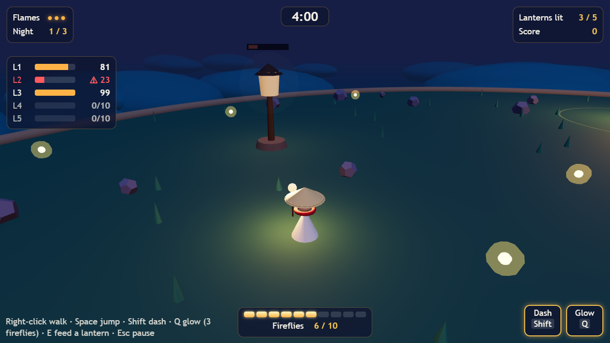
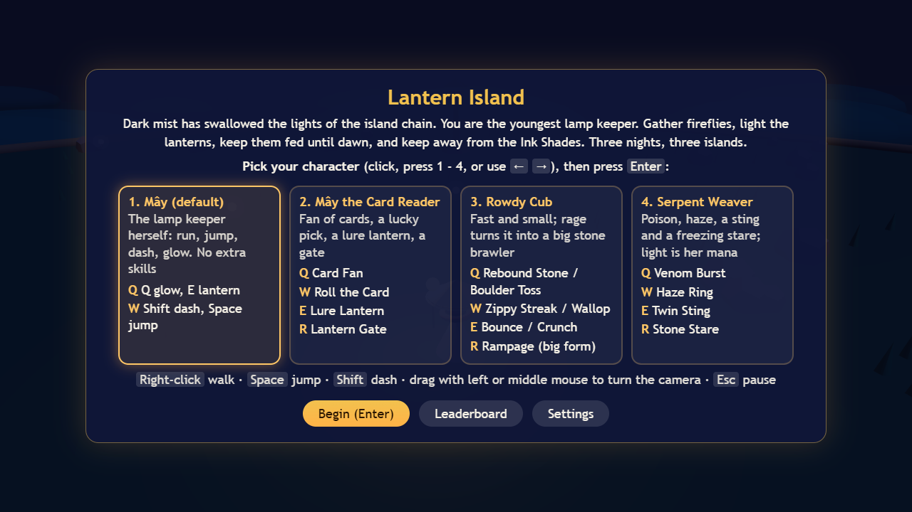

# Lantern Island (Đảo Đèn Lồng)

**Demo video:** _coming in Phase 4 (link goes here)_

A small 3D night game in three nights. Dark mist has swallowed the lights of an island chain. You play **Mây**, a girl in a conical hat with a little lantern on a stick. Pick up fireflies, carry them to the big lanterns, light them and keep them fed until dawn: lanterns burn down, and shades drain the weak ones. Ink Shades (purple-black blobs) chase you; a touch costs a flame and makes you drop fireflies. Glow to push them away. Night 2 adds grey Drifters that steal fireflies, night 3 adds a gusting wind. The island gets brighter with every lantern you light.

Everything is built from Three.js shapes, lights and WebAudio synthesis, no downloaded assets. The game rules are plain TypeScript in `src/sim/` and are used both by the 3D game and by the headless mode.





## Run it (3 commands)

Needs Node 20 or newer (Node 22 is what the CI uses).

```
npm ci
npm run build
npm start
```

`npm start` serves the built game on http://localhost:4173, opens your browser and keeps the leaderboard in `data/leaderboard.json`. Pick a character with the arrow keys (or click, or 1-4) and press Enter. For development use `npm run dev` instead (Vite, http://localhost:5173; the leaderboard then lives in the browser).

**System requirements.** A computer with a GPU that can run WebGL 2 in a current Chrome, Edge or Firefox; about 300 MB of free memory; 1280x720 or larger. Nothing is downloaded while playing.

## The three nights

| night | island | lanterns | time | what is new |
|---|---|---|---|---|
| 1 | Đảo Bến, one round island (radius 40) | 5 | 4:00 | |
| 2 | Đảo Cau, two islands and a bamboo bridge | 6 | 4:30 | bounce pads, Drifters (Gió Lạc), the wind charm (Bùa Gió) |
| 3 | Đảo Chuông, three floors, ramps, a bell tower | 7 | 5:00 | cliffs, a bounce pad to the top floor, strong wind every 30 s, faster shades |

**Win** a night by being alive at dawn with at least 60% of the lanterns lit (3 of 5, 4 of 6, 5 of 7). Lighting every lantern does *not* end the night early. **Lose** it when your 3 flames are gone, or when dawn comes with too few lanterns lit. Win night 3 and the whole island wakes up. Flames refill every night.

### Lanterns burn down (new in Phase 3)

- A lit lantern has **100 fuel** and loses 1 fuel every second. At 0 it goes out and forgets the fireflies in it, but it remembers it was lit once.
- **Feed it**: stand within 2 m and press the lantern key with fireflies in your hands. Every firefly gives +10 fuel (up to 100) and +5 points.
- **Light it again** after it went out: only 5 fireflies, +5 points each and +40 for the relight.
- The **safe zone** (6 m, no shades) only exists while a lantern has 30 fuel or more. Below 30 the lantern blinks, its bar turns red and shows a warning sign, and a shade that is wandering will walk to it, stand next to it and **drain 5 fuel per second**.
- A shade that sees you within 6 m of the lantern it is draining turns on you. A glow on a draining shade is worth 15 points.
- **Capacity grows**: you can carry 10 fireflies, +2 for every lantern you light (also relights), up to 20.

## Controls

| input | action |
|---|---|
| right mouse button | walk to the point under the mouse (hold to keep following it) |
| left or middle mouse drag | turn the camera (the 3D view still rotates) |
| arrow keys | walk with the keyboard (cancels a click target) |
| Space | jump |
| Shift | dash (14 m/s for 0.2 s, 1.5 s cooldown) |
| Q (default Mây) / D | glow: stuns and pushes away Ink Shades within 5 m, costs 3 fireflies, 3 s cooldown |
| E (default Mây) / F | put the fireflies you carry into the nearest lantern that is unlit or not full (within 2 m) |
| Q W E R (champions) | the champion's four skills, aimed at the mouse |
| Esc or P | pause (menu: resume, restart night, settings, back to menu) |
| Enter | confirm: begin, next night, play again |

Fireflies and charms are picked up automatically when you walk over them. Every key of the table (except the mouse) can be changed in Settings.

## How scoring works

| event | points |
|---|---|
| each firefly put into a lantern (to light it, relight it or feed it) | 5 |
| a lantern lit for the first time | 100 |
| a lantern lit again | 40 |
| each Ink Shade hit by a glow (each time) | 5 (15 if it was draining a lantern) |
| **at dawn, win only:** each lit lantern | 50 + its fuel (whole number) |
| **at dawn, win only:** each flame left | 50 |

There is no time bonus any more. The game total is the sum of the nights you won.

## Settings and accessibility

Settings are saved on your computer (browser storage).

- **Keys**: click a key, press the new one. If it is already used you get a warning ("E is already used for ...") and nothing changes. *Restore default keys* puts them back.
- **Subtitles for sounds** (on by default): short text lines such as "(low growl) An Ink Shade appeared on your left ←", "(beep) L2 is running low", "10 seconds to dawn". Nothing important is told by sound alone.
- **Easy-to-tell-apart colours**: shades turn cyan `#00B3FF`, warnings white `#FFFFFF`; low fuel is always shown with a warning sign and blinking as well as colour.
- **Reduce motion**: no screen flash, no blinking, no camera or lantern flicker, no swaying fireflies, no wind leaves.
- **Large text**: every text is 25% bigger. At 1280x720 the smallest UI text is 18 px.

## Leaderboard

After the last night is won, or after any loss, the end card asks for a name (3 to 12 letters, digits or underscore; Vietnamese letters are fine). The top 10 are kept, best score first (an equal score keeps the earlier entry on top). *Leaderboard* in the main menu shows them. With `npm start` they are stored in `data/leaderboard.json`; in `npm run dev` or any other static hosting they are stored in the browser.

```
node dist/headless/launcher.js --export-leaderboard out.json      # writes {"entries": [ ... ]}
```

## Tests and headless mode

```
npm test                 # builds the CLI, then runs vitest
npm run typecheck
npm run check            # typecheck + tests + determinism check
npm run evidence         # runs scenarios, writes docs/evidence/phase-3/**
npm run evidence:extras  # champion kits did not change headless output
```

The headless CLI runs the same rules without a window or GPU, 60 ticks per second, and writes JSON lines (snapshots, events, a final `end` line). A full night (up to 18,000 ticks) takes well under a second here.

```
node dist/headless/cli.js --seed 1 --night 1 --ticks 600 --out out.jsonl
node dist/headless/cli.js --seed 1 --night 2 --scenario scenarios/night2_pad/scenario.json --inputs scenarios/night2_pad/inputs.json --ticks 130 --out pad.jsonl
```

Options: `--seed <int>`, `--night 1|2|3`, `--scenario <file>`, `--inputs <file>`, `--ticks <int>`, `--out <file>`, `--snapshot-every <int>` (default 10). Exit code 0 on success, 2 if the inputs or scenario file is unreadable or malformed, 1 for other errors (message on stderr).

A scenario (see `scenarios/` for more than 60):

```json
{ "player": { "pos": [0, 0, 0], "carried": 0, "flames": 3, "dash_cd_ticks": 0, "charm_ticks": 0 },
  "random_motes": false, "random_shades": false, "random_drifters": false, "wind_enabled": false,
  "motes": [[0, 0, 5]],
  "shades": [{ "pos": [10, 1, 0], "state": "chase" }],
  "drifters": [{ "id": "D1", "pos": [8, 2, 0] }],
  "lanterns": [{ "id": "L1", "pos": [0, 0, 25], "deposited": 0 }, { "id": "L2", "lit": true, "fuel": 20 }],
  "time_left_s": 240 }
```

Lantern fields: `lit`, `fuel` (0-100; `lit: true` alone means 100), `deposited`, `ever_lit`; a shade can have `target_lantern_id`; the player can have `successful_lights`. Inputs (`dash` and `pause` were added in v1.1):

```json
{ "frames": [ { "tick": 0, "move": [0, 1], "cam_yaw_deg": 0 }, { "tick": 120, "interact": true }, { "tick": 121, "interact": false, "dash": true } ] }
```

The contract for the grader is in `game.contract.json` (`tuning` equals `src/sim/tuning.ts`, a test checks that). All numbers are the lab's standard numbers from the tickets; where a ticket left something open I made a choice and listed it with an id in `docs/notes/assumptions.md` (P2-*, P3-*, P4-*).

### Things that differ from what you might guess

- **Running starts and stops in 0.1 s** (6 ticks), so after 60 ticks of running you are 5.75 m away, not 6.
- **Fireflies score when put into a lantern, not when picked up.**
- **Night 3 starts at (0,0,-30)** because the centre is inside the top floor (the ticket text I read gave no start point).
- `fall_enabled` is `true`: falling below Y = -10 costs a flame and all fireflies, then you respawn after 1 s.
- **Fuel is counted in 1/60 units** inside the sim so a lantern loses exactly 1 fuel per 60 ticks with no rounding drift; the output shows one decimal. A lantern with exactly 30 fuel still has its safe zone, with 29.98 it does not.

## Benchmark and soak (Phase 4)

```
npm run build
npm run bench      # node scripts/bench.mjs --seed 42 --duration 30 --out bench.json
npm run soak       # node --expose-gc dist/headless/soak.js --seed 7 --nights 10 --out soak.json
```

**Benchmark.** `scripts/bench.mjs` serves the build, opens it in Chrome or Edge (headless, 1280x720, vsync and the frame limiter switched off with `--disable-gpu-vsync --disable-frame-rate-limit`; pass `--headed` for a normal window, `--browser <path>` or the `CHROME_PATH` variable if the browser is not found), and the page plays the standard scene: night 1, 200 Ink Shades and 100 fireflies, lanterns L1-L3 lit with 100 fuel, nothing spawns, nobody gets hurt, nothing is picked up, fuel does not burn, the night does not end, Mây stands at the centre and the camera circles it (radius 30, height 15, one lap per 15 s) after 3 s of warm-up. My own champions and skill effects are not in that scene. It writes `bench.json` with `avg_fps`, `p1_low_fps`, `frame_ms_p95`, `frames`, `load_ms`, `peak_mem_mb`, `vsync_off`, `renderer`, `os`. Two things to know: `peak_mem_mb` is the JavaScript heap of the page, because a web page cannot read the memory of the browser process (the file says so); and `vsync_off: true` means the switches were passed, I cannot read back whether the graphics driver obeyed.

My committed run: **119.6 fps average, 40.8 fps 1% low, p95 13.6 ms, load 1196 ms** on `Windows_NT 10.0.26300 x64; 12th Gen Intel(R) Core(TM) i5-12500H x16; 7.7 GiB RAM; chrome.exe 158.0.8127.36 (headless=new)`, renderer `three.js r187 (WebGL2) on ANGLE (Intel, Intel(R) UHD Graphics (0x00004626) Direct3D11 vs_5_0 ps_5_0, D3D11)` (a laptop with an integrated GPU, with other programs open). The runs vary: other runs on the same machine gave 91 to 145 fps average and 28 to 37 fps for the 1% low, so the 1% low threshold (30) is close and can be missed on a bad run. The ticket's thresholds (average above 60, 1% low above 30, load under 10 s) are checked in `docs/evidence/phase-4/README.md`: read the result there, I do not claim it here.

**Soak.** `dist/headless/soak.js` plays 10 nights in one process (night 1, 2, 3, 1, ... with seed 7 + i) with random inputs and writes the number of crashes, the results, and the process memory after the first night is loaded and after the last one is reset (a short warm-up run and a forced garbage collection come first so start-up cost is not counted as a leak). The committed `soak.json`: 0 crashes, memory 48 MB -> 49.4 MB, 0.2 s. The random players lose every night within a few seconds of game time, so the run is short.

## Characters

Everything below the default character is live-game only. It lives in `src/extras/` and is wired in by `src/render/game.ts`; `src/sim` and `src/headless` never import it, so **headless mode does not contain it**. `npm run evidence:extras` re-runs every scenario and checks that the output is byte-identical to the files recorded in `docs/evidence/phase-2`.

**Default: Mây.** No extra skills: run, jump, dash, glow (Q), put fireflies in a lantern (E). The default character is selected when the game starts.

The other characters replace Q, W, E and R with their own skills (D glows and F lights, as the base actions). Names, art and numbers are my own; the shape of the kits is inspired by champion kits in MOBA games. Shades have 3 "ink" in the live game: skills thin it, at 0 the shade dissolves into a firefly (30 points).

**Mây the Card Reader**

| key | skill | what it does | cooldown |
|---|---|---|---|
| Q | Card Fan | costs 1 firefly. 3 cards fly toward the mouse in a fan and pass through shades: each is stunned 1 s and loses 1 ink | 2.5 s |
| W | Roll the Card | a card flips gold, blue, pink over your hat. Press W again to stop (it stops by itself after 3 s) and the card acts at once. **Gold**: every shade within 7 m freezes 2.5 s. **Blue**: +3 fireflies. **Pink**: run 1.5x faster for 4 s | 8 s |
| E | Lure Lantern | costs 1 firefly. Throw a bright lantern up to 10 m toward the mouse. For 4 s shades within 16 m of it walk to the lantern instead of to you, then it bursts: stun 2 s and 1 ink | 14 s |
| R | Lantern Gate | put the mouse near a lantern and press R. After 1.5 s you appear 2 m from it. A hit cancels it | 25 s (5 s if cancelled) |

**Rowdy Cub** (no mana, uses a rage bar; rage comes from hitting shades and from being hit)

| key | small form | big form (rage full, 10 s) |
|---|---|---|
| Q | Rebound Stone: a stone flies out, comes back, slows what it touches both ways, catching it refunds 40% of the cooldown | Boulder Toss: a big boulder, 2 ink, slows, does not return |
| W | Zippy Streak (passive): every 3 hits within 6 s you sprint 1.3x for 2 s | Wallop: after a short wind-up, a cone in front is stunned 1.25 s and thinned |
| E | Bounce: leap up to 6 m toward the mouse; shades where you land are slowed | Crunch: same leap, wider landing, stronger slow and 1 ink |
| R | needs the big form | Rampage: shades within 5 m are thrown back 6 m and stunned 1.5 s |

The cub is 10% faster than Mây when small and grows 1.55x when big.

**Serpent Weaver** (fireflies are her mana, +10% move speed always)

| key | skill | what it does | cooldown |
|---|---|---|---|
| Q | Venom Burst | 1 firefly. A circle appears at the mouse (up to 9 m) and bursts after 0.4 s: shades inside are poisoned (1 ink over 3 s). If it hits, you run 1.4x faster for 3 s | 3.5 s |
| W | Haze Ring | 1 firefly. After 0.5 s a haze stays for 5 s at the mouse: shades inside are slowed to half speed and kept poisoned | 14 s |
| E | Twin Sting | free. Hits the shade nearest to the mouse within 8 m for 1 ink (2 if it is poisoned). If it dissolves you get 2 fireflies back | 2 s |
| R | Stone Stare | 2 fireflies. An 80 degree cone, 9 m, toward the mouse: shades inside freeze 2 s and lose 1 ink | 25 s |

The rules of every kit are tested in `tests/extras.test.ts`, `tests/champions.test.ts` and `tests/steer.test.ts`.

## Repository map

- `src/extras/`: the card skills (live mode only)
- `docs/spec/`: the Phase 1 spec (copied as given), the Phase 2, 3 and 4 specs (my transcriptions of Ticket-02, -03, -04) and the Phase 2 acceptance criteria
- `docs/notes/`: assumptions, AI usage log, where the AI was wrong, evaluation, retro
- `docs/evidence/`: generated evidence (`phase-1/` to `phase-4/`, each `README.md` is the table), `harness-check.md` for the hooks
- `bench.json`, `soak.json`: the committed Phase 4 runs
- `docs/img/`: screenshots; `docs/notes/phase-4-manual-checks.md`: what I checked by hand
- `AGENTS.md`, `CLAUDE.md`, `.claude/`, `scripts/hooks/`: the AI harness
- `docs/lab-brief/`: the lab's own files (README, rules, rubric, guide)
- `CREDITS.md`, `LICENSE` (MIT)
